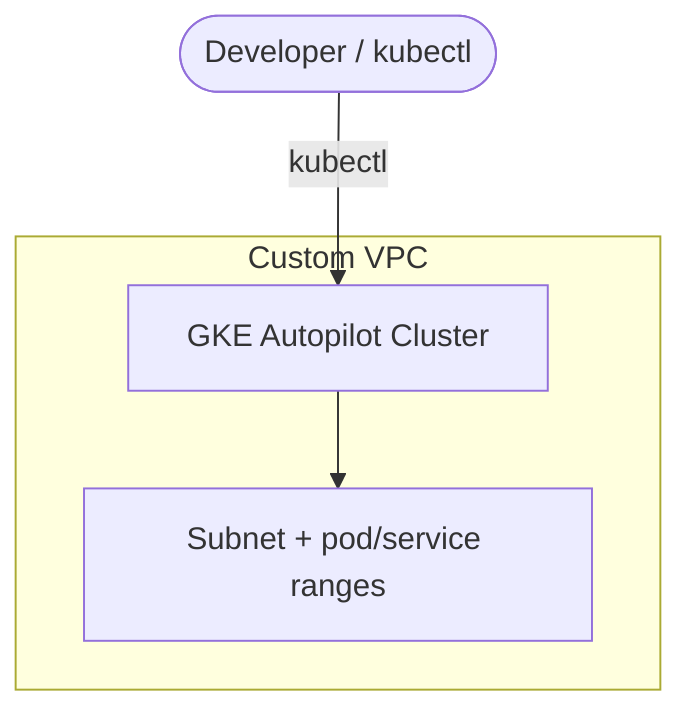

# GCP GKE Autopilot Cluster (Terraform)

> Fully managed Kubernetes on Google Cloud with GKE Autopilot on a VPC-native network — provisioned with Terraform.
> **Author:** Muhammad Ahmad · **IaC:** Terraform · **Cloud:** GCP


---

## 📌 Overview

- A custom **VPC** with a subnet that has **secondary ranges** for pods and services (VPC-native).
- A **GKE Autopilot** cluster — Google manages nodes, scaling, and security; you just run workloads and pay per pod.

## 🏗️ Architecture

> 🎨 **Interactive diagram (industry-standard icons):** [open in Lucid — page 21](https://lucid.app/lucidchart/3da75ce3-ea66-4296-81b3-00d20a60435b/edit)



## 🚀 Deploy

```bash
cd terraform
gcloud auth application-default login
terraform init
terraform apply -var="project_id=YOUR_PROJECT_ID"

$(terraform output -raw get_credentials_command)
kubectl get nodes
```

## 🧹 Clean up

```bash
terraform destroy -var="project_id=YOUR_PROJECT_ID"
```

## 💰 Cost note

Autopilot bills for the **pod resources** you run plus a small cluster management fee. No idle node cost.

## 🔐 Production hardening (next steps)

- Make it a **private cluster** with authorized networks.
- Enable **Workload Identity** for GCP IAM access from pods.
- Add **Cloud NAT** for controlled egress.

---

*Built and maintained by **Muhammad Ahmad**.*
