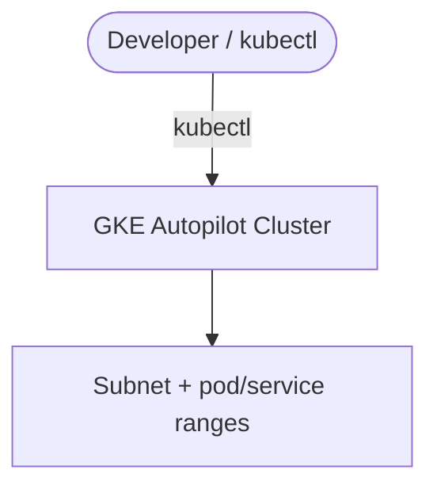

# Architecture Diagram — GCP GKE Autopilot

## Lucid diagram

- **View:** https://lucid.app/lucidchart/62f32643-f26c-4ac5-9300-2eacfb0b5fb7/view
- **Edit:** https://lucid.app/lucidchart/62f32643-f26c-4ac5-9300-2eacfb0b5fb7/edit

## Lucid prompt (reusable)

```
Create a GCP architecture diagram titled "GCP GKE Autopilot Cluster".
A Developer uses kubectl against a GKE Autopilot Cluster that runs inside a custom VPC
with a subnet that has secondary ranges for pods and services. Label the arrows.
Clean, professional Google Cloud colors.
```

## Mermaid source


